# TekDoctor — AMC Phase 3 Pre-Implementation Audit Report

## 1. Executive Overview

This audit report evaluates the existing AMC implementation from Phase 1 and Phase 2 in the TekDoctor monorepo and outlines the exact architecture, database migrations, services, schedulers, APIs, and UI enhancements required to complete **AMC Phase 3**.

---

## 2. Existing Implementation Analysis

### Database & Schema (from Phase 1)
- **`amc_plans`**: Defines standard public catalog plans (`AMC-STD-10`, `AMC-CORP-25`, `AMC-ENT-50`) with `default_device_capacity`, `base_price`, `duration_months`.
- **`amc_requests`**: Stores customer/company initial inquiries with `requested_device_count`, status (`pending`, `under_review`, `offered`, `rejected`).
- **`amc_contracts`**: Complete contract lifecycle entity with:
  - `status`: `draft`, `offered`, `accepted`, `rejected`, `active`, `expired`, `cancelled`, `suspended`
  - `approval_status`: `pending_approval`, `approved`, `rejected`
  - `payment_status`: `unpaid`, `pending_verification`, `paid`, `failed`
  - Date fields: `start_date`, `end_date`, `offer_valid_until`, `selection_deadline`
  - Renewal fields: `is_renewal` (boolean), `previous_contract_id` (FK to `amc_contracts`), `contract_type` (`'standard'`, `'custom'`, `'renewal'`)
- **`amc_covered_devices`**: Authoritative device allocation mapping `contract_id` + `device_id` with `amc_tag`, `coverage_start_date`, `coverage_end_date`, `status` (`'active'`, `'decommissioned'`, `'replaced'`).
- **`amc_device_replacements`**: Manages hardware device swaps under SLA with Admin review.
- **`amc_contract_history`**: Audit trail recording immutable actions (`CONTRACT_CREATED`, `OFFER_ACCEPTED`, `PAYMENT_VERIFIED`, etc.).

### Backend Services & Controllers (from Phase 1 & 2)
- Ticketing and Repair Eligibility: `resolveDeviceAmcEligibility` evaluates `approval_status === 'approved'`, `payment_status === 'paid'`, `status === 'active'`, and `start_date <= targetDate <= end_date`.
- Payment & Invoicing: Seamless Razorpay online checkout and offline bank transfer verification with automatic invoice generation.
- Device Allocation: Capacity-checked atomic device assignments rejecting duplicates and overflow.

### Notifications & Email Infrastructure
- `sendAmcNotification`: Writes in-app notifications to `notifications` table and triggers emails via `sendCustomerNotification` and `sendAdminNotification` in `server/utils/email.utils.js`.

### PDF Generation Infrastructure
- `client/src/utils/billGenerator.ts` actively uses `html2pdf.js` for tax invoices, payment receipts, and estimates with A4 page sizing and clean typography.

---

## 3. Gap Analysis: Missing, Broken, or Incomplete Features

| Feature Area | Current State | Missing / Incomplete Requirements |
| :--- | :--- | :--- |
| **1. Expiry Reminders** | Not implemented | No scheduler monitoring contracts near expiry; no `amc_expiry_reminders` tracking table to ensure idempotency across restarts/multi-workers; no configurable reminder milestones in settings. |
| **2. Contract Expiry** | Partially reactive | Expired contracts are blocked at runtime in `resolveDeviceAmcEligibility`, but their status in `amc_contracts` remains `'active'` indefinitely without an automated cron/scheduler sweep; offer expiration is not validated in `acceptAmcOffer`. |
| **3. AMC Renewal** | Schema fields exist (`is_renewal`, `previous_contract_id`), but no workflow | No dedicated API or UI workflow for renewing contracts; no reduced-capacity selection enforcement; no deadline reminder; no gap-renewal handling ensuring prospective dates. |
| **4. Certificate / PDF** | Invoices have PDF; AMC contracts do not | No backend certificate data contract (`GET /contracts/:id/certificate`); no AMC compliance certificate generator; no Download Certificate CTA in Admin or Company UI. |

---

## 4. Database Migration Requirements

Add migration **`2026_13_amc_expiry_reminders_and_phase3`** in `server/models/db.init.js`:
1. Create table **`amc_expiry_reminders`**:
   - `id`, `contract_id`, `company_id`, `milestone_days`, `expiry_date`, `recipient_email`, `notification_id`, `status` (`'sent'`, `'failed'`), `sent_at`, `error_message`.
   - Unique constraint: `UNIQUE KEY uk_contract_milestone_expiry (contract_id, milestone_days, expiry_date)` to mathematically prevent duplicate dispatches.
2. Modify `amc_covered_devices.status`:
   - Extend ENUM to include `'expired'`: `ENUM('active', 'decommissioned', 'replaced', 'expired')`.
3. Seed `site_settings`:
   - Insert `amc_reminder_milestones_days` default `'30,15,7,1'` under group `'amc'`.

---

## 5. Architectural Implementation Plan

```mermaid
flowchart TD
    subgraph Scheduler ["AMC Maintenance Scheduler (amc.scheduler.js)"]
        S1["Periodic Tick (Startup + Hourly)"] --> S2["Advisory Mutex / Worker Lock"]
        S2 --> S3["Task 1: Expiry Sweep"]
        S2 --> S4["Task 2: Reminders Sweep"]
        S2 --> S5["Task 3: Selection Deadline Sweep"]
        
        S3 -->|"end_date < Today"| E1["Mark Contract 'expired'"]
        E1 --> E2["Mark Covered Devices 'expired'"]
        E1 --> E3["Log 'CONTRACT_EXPIRED'"]
        
        S4 -->|"DATEDIFF(end_date, Today) in Config"| R1["Check amc_expiry_reminders"]
        R1 -->|"Not yet sent"| R2["Atomic Insert amc_expiry_reminders"]
        R2 --> R3["Send In-App & Email Alert"]
    end

    subgraph Renewal ["Renewal Lifecycle"]
        RN1["Company / Admin Initiates Renewal"] --> RN2["Validate Previous Contract"]
        RN2 --> RN3["Create Renewal Contract (is_renewal=1, previous_id=prev.id)"]
        RN3 --> RN4["Company Selects Covered Devices (<= Capacity)"]
        RN4 --> RN5["Approval & Payment Verification"]
        RN5 --> RN6["Coverage Activates on start_date"]
    end

    subgraph Compliance ["Certificate Generation"]
        C1["Authoritative Backend API: GET /contracts/:id/certificate"]
        C1 --> C2["Frontend: amcCertificateGenerator.ts (html2pdf.js)"]
        C2 --> C3["Download Official AMC SLA Certificate PDF"]
    end
```

---

## 6. Implementation Sequence

1. **Step 1: Database Migration**: Add `amc_expiry_reminders` table, extend covered devices status, and seed reminder settings in `server/models/db.init.js`.
2. **Step 2: Service Methods**:
   - Implement `processContractExpiries` and `processExpiryReminders` with worker mutex safety.
   - Implement `createAmcRenewalContract`, `requestAmcRenewal`, and enforce offer expiration in `acceptAmcOffer`.
   - Implement `getContractCertificateData` with strict multi-tenant authorization.
3. **Step 3: Background Scheduler**: Create `server/schedulers/amc.scheduler.js` and register in `server/server.js`.
4. **Step 4: Controller & Routes**: Expose certificate, renewal, reminders history, and maintenance endpoints in `server/controllers/amc.controller.js` and `server/routes/amc.routes.js`.
5. **Step 5: Frontend Certificate & Renewal**:
   - Create `client/src/utils/amcCertificateGenerator.ts`.
   - Update `client/src/pages/company/CompanyAmcManagement.tsx` (renewal modal, device selection, download certificate).
   - Update `client/src/pages/admin/AdminAmcManagement.tsx` (renewal offer modal, reminders audit tab, download certificate).
6. **Step 6: Comprehensive Automated Verification**:
   - Create `server/tests/verify-amc-phase3.js`.
   - Run all regression suites (Phase 1, Phase 2, Four-Fixes, Ticket, Consistency, Dropdowns).
   - Run `npm run build --prefix client`.

